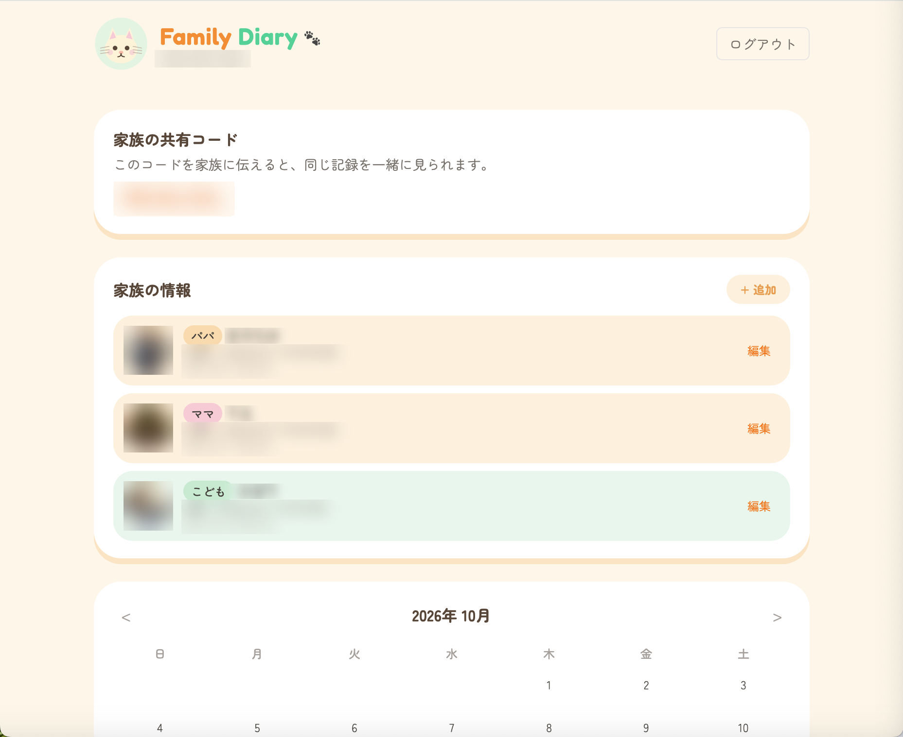
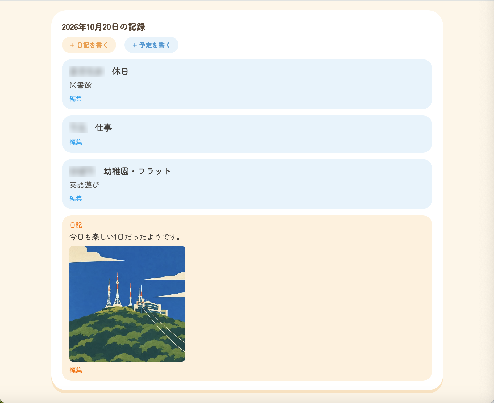

# Family Diary 🐾

家族みんなで使える、育児・家族の予定管理アプリです。
子どもがいる家庭向けに、幼稚園の予定、パパ・ママの仕事や休日、日々の日記と写真を、1つのカレンダーにまとめて見られます。

Laravel の API と、Vite + Tailwind CSS の画面(ブラウザ向けの1ページアプリ)で作っています。

## 画面





(個人情報はぼかしています)

## 主な機能

- **家族で共有:** 家族ごとの招待コードで、同じ記録を一緒に見られます。
- **家族の情報:** パパ・ママ・こども(ほか祖父母なども)を、写真と生年月日つきで登録できます。「○歳○ヶ月(生まれて○日目)」を自動で表示します。
- **カレンダー:** 月ごとの表示で、記録のある日に印が付きます。日付を選ぶと、その日の予定と日記が見られます。
- **予定:** 家族のだれの予定かをタブで選んで登録できます。編集と削除もできます。
- **日記と写真:** その日の日記を書いて、写真を付けられます。あとから文章の編集、写真の削除もできます。

## 使っている技術

| 分野 | 技術 |
| --- | --- |
| サーバー | PHP 8.5 / Laravel 13 |
| 認証 | Laravel Sanctum(トークン認証) |
| データベース | MySQL 8.4 |
| 画面 | Vite / Tailwind CSS 4 / JavaScript(フレームワークなし) |
| 開発環境 | Docker(Laravel Sail) |

## 設計のポイント

- **家族ごとにデータを分ける:** 予定・日記・写真・家族の情報はすべて `family_id` を持ち、どのAPIでも「ログイン中のユーザーの家族のデータか」を確認します。別の家族のデータは、読むことも変えることもできません(403を返します)。
- **API と画面を分ける:** 画面は `/api` だけを呼び出します。データの出し入れはすべて API が担当します。
- **写真の扱い:** 写真は `public` ディスクに保存し、日記・予定どちらにも付けられるよう、ポリモーフィックなリレーション(`media` テーブル)にしています。
- **変更の履歴を migration に残す:** 予定の種類を増やす、入力を任意にするなどの変更も、すべて migration として記録しています。

## API(主なもの)

認証が必要なものは、`Authorization: Bearer <トークン>` を付けて呼びます。

| メソッド | パス | 内容 |
| --- | --- | --- |
| POST | `/api/register` | 新規登録(招待コードで既存の家族に参加も可能) |
| POST | `/api/login` | ログイン(トークンを返す) |
| GET | `/api/families` | 自分の家族の情報と招待コード |
| GET / POST / PUT / DELETE | `/api/children` | 子どもの管理 |
| POST | `/api/children/{id}/photo` | 子どもの写真の変更 |
| GET / POST / PUT / DELETE | `/api/family-members` | パパ・ママなどの管理 |
| POST | `/api/family-members/{id}/photo` | 写真の変更 |
| POST | `/api/children/{id}/school-events` | 子どもの予定の登録 |
| POST | `/api/family-members/{id}/school-events` | パパ・ママの予定の登録 |
| PUT / DELETE | `/api/school-events/{id}` | 予定の編集・削除 |
| POST / PUT / DELETE | `/api/diary-entries` | 日記の登録・編集・削除 |
| POST | `/api/diary-entries/{id}/media` | 日記への写真の追加 |
| DELETE | `/api/media/{id}` | 写真の削除 |
| GET | `/api/calendar/{year}/{month}` | 月ごとの記録の件数 |
| GET | `/api/calendar/day/{date}` | 1日分の予定と日記 |

## 動かし方(ローカル)

作者の環境(Mac + Docker Desktop)で動作確認済みです。PHP、Composer、Docker Desktop が入っている環境で、次の順に実行します。

```bash
# 1. 取得して、設定ファイルを用意する
git clone https://github.com/hibarie/family-diary.git
cd family-diary
cp .env.example .env
composer install
```

`.env` を開き、データベースの設定を MySQL 用に書き換えます。

```
APP_PORT=8000
DB_CONNECTION=mysql
DB_HOST=mysql
DB_PORT=3306
DB_DATABASE=laravel
DB_USERNAME=sail
DB_PASSWORD=password
```

```bash
# 2. 起動して、準備する
./vendor/bin/sail up -d
./vendor/bin/sail artisan key:generate
./vendor/bin/sail artisan migrate
./vendor/bin/sail artisan storage:link

# 3. 画面のファイルを動かす
./vendor/bin/sail npm install
./vendor/bin/sail npm run dev
```

ブラウザで http://localhost:8000 を開き、「はじめて使う」から登録すると使えます。

## 今後の予定

- インターネット上への公開(どこからでもスマホで使えるようにする)
- 予定を、TimeTree などのカレンダーアプリに書き出す(iCalendar 形式)
- 日記と予定の、全期間の検索
